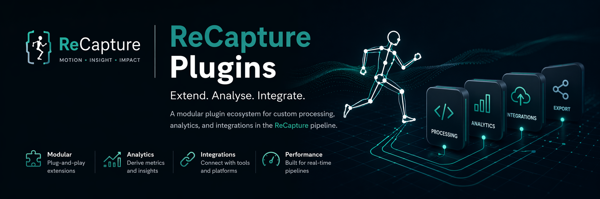

# ReCapture Biomechanics Plugins



Biomechanics analysis plugins for ReCapture V3. The repository is distributed
as one installable Python package, `recapture-biomechanics`, containing five
independently selectable movement analyses.

## Included movements

| Plugin ID | Movement | Main results |
|---|---|---|
| `bath-gait` | Walking and running gait | Speed, temporospatial distributions, joint measures, bilateral waveforms, and gait events |
| `bath-jump` | Jumping | Jump count and timing, joint measures, bilateral waveforms, and take-off/landing events |
| `bath-sit-to-stand` | Sit-to-stand | Cycle and phase durations, joint measures, bilateral waveforms, and phase events |
| `bath-rowing` | Ergometer rowing | Stroke count, stroke rate and duration, joint measures, bilateral waveforms, and catch/finish events |
| `bath-cycling` | Ergometer cycling | Revolution count, cadence and duration, joint measures, bilateral waveforms, and TDC/BDC events |

All analyses return typed ReCapture V3 outputs. Depending on the movement,
these include scalar values, per-cycle box plots, left/right time-normalised
line charts, and detected-event tables.

---

## Architecture

- **ReCapture V3** records videos and produces processed motion-capture assets.
- **Plugin manager** discovers this installed package and starts an isolated
  Python analysis process.
- **Movement plugin** consumes only the manager-approved files and runs the
  University of Bath biomechanics processor.
- **V3 adapter** converts the movement results into validated SDK outputs for
  the Analysis screen.

The current package retains the established movement-processing implementations
under `plugins/logan_wade_university_of_bath/`. V3 entry points and result
adapters live under `src/recapture_biomechanics/`.

---


## ReCapture V3 entry points

The package registers all five analyses in the standard `recapture.analysis`
entry-point group:

```text
bath-gait = recapture_biomechanics.gait.entrypoint:run
bath-jump = recapture_biomechanics.jump.entrypoint:run
bath-sit-to-stand = recapture_biomechanics.sit_to_stand.entrypoint:run
bath-rowing = recapture_biomechanics.rowing.entrypoint:run
bath-cycling = recapture_biomechanics.cycling.entrypoint:run
```

The analyses consume manager-approved processed assets rather than searching
participant directories. Every movement requires:

- `scaled-model.osim`
- `marker-trajectories-augmented.trc`
- `inverse-kinematics.mot`

Gait additionally requires:

- `processing-metadata.json`

## Import into ReCapture V3

### Install through the ReCapture app

1. Open ReCapture V3.
2. Open **Settings**, then select **Plugins**.
3. Select **Discover plugins**.
4. Choose the root of this repository—the directory containing
   `pyproject.toml`—and confirm the selection.
5. Wait for installation and discovery to finish.
6. Confirm that all five Bath analyses appear in the plugin list and are
   enabled.

ReCapture installs the package into its managed Python environment. Do not
select an individual movement directory such as `plugins/.../gait`; select the
repository root.

To run an analysis, process an exercise first so that its model, marker, and
inverse-kinematics assets exist. Open the exercise in the **Analysis** screen,
choose the movement plugin that matches the recorded task, adjust its settings,
and run the analysis.

### Install for local development

When developing ReCapture and this repository side by side, install the V3
analysis SDK first and then install this package in editable mode:

```powershell
python -m pip install -e C:\path\to\Recapture-V3\python\recapture-analysis-sdk
python -m pip install -e C:\path\to\ReCapture-Plugins
```

Verify that Python discovers every entry point:

```powershell
python -m recapture_analysis.discovery
```

The discovery result should contain these IDs:

```text
bath-gait
bath-jump
bath-sit-to-stand
bath-rowing
bath-cycling
```

If ReCapture uses a different Python installation, set
`RECAPTURE_PYTHON_EXECUTABLE` to the executable containing both installed
packages before starting the app. Restart ReCapture after changing the Python
environment or reinstalling the package.

### Requirements and troubleshooting

- Python 3.11 or later is required.
- The selected Python environment must support the OpenSim Python bindings.
- An analysis is available only for a completed, processed exercise containing
  all assets declared by that plugin.
- If no plugins appear, run `python -m recapture_analysis.discovery` in the same
  environment and check its error output.
- If installation fails, confirm that the selected directory contains
  `pyproject.toml`, and that pip can install the declared scientific
  dependencies.
- If a movement reports no valid cycles or repetitions, verify that the chosen
  plugin matches the recorded task and review its trimming, side, filtering,
  and event-signal settings.

## Outputs and configuration

Gait publishes:

- gait speed and valid-cycle count;
- bilateral temporospatial distributions;
- discrete ankle, knee, hip, pelvis, and trunk measurements;
- time-normalised bilateral joint-angle curves; and
- detected gait-event timings.

Jump, sit-to-stand, rowing, and cycling publish their movement-specific counts
and timing measures together with discrete joint-angle distributions,
time-normalised bilateral joint-angle curves, and detected movement events.

The Analysis screen builds configuration controls from each plugin's Pydantic
schema. Available settings include trial trimming and coordinate filtering,
plus movement-specific options such as gait style, side, cycle limits, and the
signal used for event detection.

---

## Use Cases

- Gait analysis
- Jump analysis
- Sit-to-stand analysis
- Ergometer rowing analysis
- Ergometer cycling analysis
- Rehabilitation metrics
- Sports performance tracking
- Real-time feedback systems
- Data export pipelines

---

## Contributing

The old `OLD_movement_processing_main/` tree remains a migration reference and
is not a V3 entry point. The namespaced movement processors under
`plugins/logan_wade_university_of_bath/` and the shared `recapture_core`
package are runtime dependencies included in the wheel. New V3 integration,
configuration, and result-adaptation code belongs under
`src/recapture_biomechanics/`.


---

## License

See [LICENSE](LICENSE) for details.
